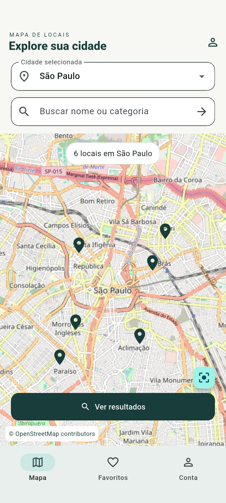
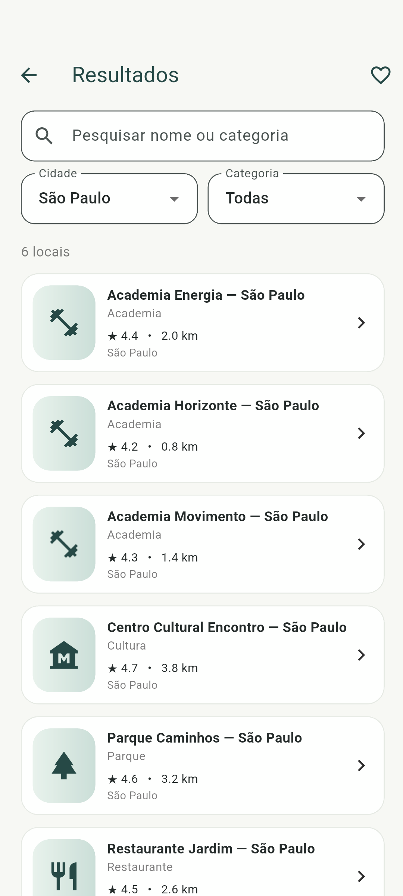
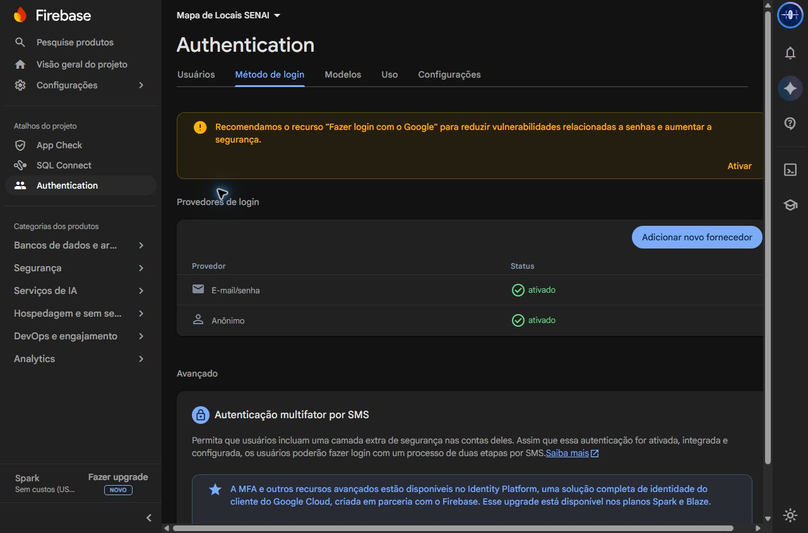
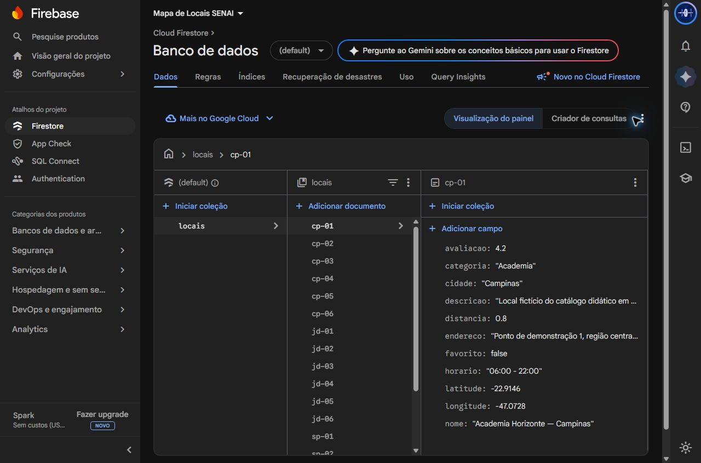

# Mapa de Locais — avaliação SENAI

## Problema e objetivo

A atividade pede uma aplicação em que pessoas selecionem cidades, encontrem estabelecimentos, filtrem resultados e consultem detalhes. O catálogo deve persistir no Cloud Firestore, com cadastro, edição, exclusão confirmada e favoritos.

O Mapa de Locais implementa esse fluxo em Flutter/Dart com três telas principais, próximas ao wireframe: mapa, resultados e detalhes. Os formulários e a conta são diálogos. Não há uma quarta tela principal.

## Critérios e rastreabilidade

Fonte: `Avaliacao_Tutorial_Flutter_Firebase_Mapa.pdf`, 18 páginas, fornecido pelo professor. Os itens avaliados são tratados como obrigatórios; mapa real e autenticação foram acrescentados ao núcleo pedido pelo usuário.

| Requisito | Implementação |
|---|---|
| RF01 Selecionar cidade | São Paulo, Campinas e Jundiaí no mapa e resultados |
| RF02 Pesquisar | Nome ou categoria, sem diferenciar maiúsculas ou acentos |
| RF03 Consultar Firestore | `LocalService.listarLocais()`, snapshots reais; sem catálogo embutido como fallback |
| RF04 Filtrar | Cidade + categoria + texto + favoritos combinados |
| RF05 Cadastrar | Formulário validado em diálogo; `locais.add()` |
| RF06 Editar | Mesmo formulário preenchido; atualização pelo ID |
| RF07 Excluir | Diálogo de confirmação; cancelar preserva o documento |
| RF08 Detalhes | Ilustração, nome, categoria, cidade, avaliação, distância, endereço, horário, descrição, coordenadas e favorito |
| RF09 Favoritar | Atualiza o campo booleano `favorito` no documento Firestore |
| RF10 Navegação | Mapa → resultados → detalhes; retorno e “Ver no mapa” centralizando as coordenadas |

Requisitos não funcionais: Android 7 ou posterior (API 24), organização por pastas, FlutterFire CLI, mensagens de erro/sucesso, controle administrativo de CRUD e regras de validação. A exigência de demonstrar sem erros deve ser avaliada pelas evidências de execução; não é uma garantia de disponibilidade de internet/Firebase/OSM.

## Tecnologias e arquitetura

Flutter 3.47.7 / Dart 3.13.5; Firebase Core, Cloud Firestore, Firebase Authentication; FlutterFire CLI 1.4.1; flutter_map 8.3.2 e latlong2; JDK 21; Android SDK; Firebase Emulator Suite e Flutter Test. Versões exatas das dependências estão fixadas nos arquivos de lock.

`lib/models`: modelo `Local`, cidades e filtros. `lib/services`: repositório Firestore e sessão. `lib/screens`: as três telas. `lib/widgets`: cards, imagem ilustrativa, estados de carregamento e formulário. `lib/dialogs`: confirmação de exclusão e conta. `tool`: catálogo de carga inicial, administração confiável e testes de regras. `test`: testes isolados de interface e lógica. `integration_test`: avaliação Android contra Firebase real.

A interface depende da abstração `LocalRepository`; a aplicação utiliza somente `LocalService` com Firestore. O repositório em memória existe exclusivamente em `test/support.dart`. Os filtros são executados sobre um catálogo limitado a 200 documentos, abordagem didática prevista pelo PDF. Para ampliar o catálogo, implementar paginação e consultas/indexação de servidor antes de aumentar esse limite.

## Banco e segurança

Projeto exclusivo `sage-mapa-senai-20261013`; banco `(default)`, edição Standard, região `southamerica-east1` (São Paulo). Configuração Android/Web gerada pela FlutterFire CLI, sem inventar chaves. Projeto Spark sem faturamento vinculado, conforme auditoria em `evidence/cloud-audit.json`.

Coleção principal: `locais`. Campos obrigatórios:

| Campo | Tipo e validação |
|---|---|
| nome | String não vazia, até 100 caracteres |
| categoria | Academia, Restaurante, Parque, Cultura ou Hospital |
| cidade | São Paulo, Campinas ou Jundiaí |
| avaliacao | Número de 0 a 5 |
| distancia | Número de 0 a 1000 km |
| horario | String não vazia, até 80 caracteres |
| descricao | String não vazia, até 2000 caracteres |
| favorito | Booleano |
| latitude / longitude | Números em −90…90 / −180…180 |
| endereco | String não vazia, até 160 caracteres |

O ID é gerado pelo Firestore em cadastros novos. A carga inicial usa IDs estáveis para não duplicar dados nem sobrescrever documentos existentes.

O app autentica visitantes anonimamente. Consultas e alteração de `favorito` exigem autenticação. Apenas UIDs presentes em `admins/{uid}` podem criar, editar outros campos ou excluir. Nenhum cliente pode gravar/listar `admins`; somente o proprietário, por console ou ferramenta administrativa confiável, pode conceder acesso. Campos adicionais ou valores fora dos limites são recusados pelas regras, mesmo se o formulário for burlado.

O favorito é global por documento, conforme RF09. Favoritos independentes por usuário aparecem como desafio extra no PDF e não foram usados para substituir o campo exigido. Usuários compartilham esse estado no catálogo didático.

Não há senha de administrador embutida. O responsável pode autorizar seu dispositivo copiando o UID pelo diálogo Conta e criando `admins/UID` no Console. Para manter esse acesso ao trocar/desinstalar o aplicativo, vincule sua conta por e-mail/senha antes, digitando a senha diretamente no diálogo. O proprietário pode revogar acesso removendo o documento administrativo. Nunca inclua tokens, senhas, chaves de serviço ou certificados privados no Git/ZIP.

## Catálogo e mapa

18 locais fictícios para avaliação: seis em cada cidade, sendo três academias, um restaurante, um parque e um centro cultural. Nome, endereço e descrição identificam a finalidade didática. As coordenadas ficam nas respectivas cidades e produzem seis marcadores ao selecionar qualquer uma delas. Horários, avaliação e distância não são medições GPS ou dados comerciais verificados.

O mapa utiliza `https://tile.openstreetmap.org/{z}/{x}/{y}.png`, com atribuição visível e link de copyright. Android envia identificação do aplicativo pelo User-Agent; a versão web usa o Referer do navegador. O cache nativo padrão de flutter_map segue os cabeçalhos HTTP. Não há pré-download, download em massa, uso offline de regiões ou headers para forçar ausência de cache. `panBuffer: 0`, zoom do app limitado de 5 a 18. O serviço público OSM não tem garantia de disponibilidade; se bloquear ou faltar rede, a lista continua acessível quando o Firestore estiver disponível. Uso de grande escala exige provedor adequado e revisão da política.

## CRUD e demonstração

Create: abrir Resultados → Cadastrar → preencher campos → Salvar; aguardar confirmação do servidor. Read: snapshots mantêm lista/detalhes atualizados. Update: menu do card → Editar; preserva ID e favorito. Delete: menu → Excluir → confirmar; Cancelar não altera o banco. Favorite: coração nos detalhes; mostra feedback após a resposta do Firestore.

O cache Firestore pode manter dados anteriores. Escritas sem conexão não são anunciadas como confirmadas antes do reconhecimento de servidor. O app não exige localização, câmera ou permissão de armazenamento para funcionar.

Roteiro: abrir mapa de São Paulo (seis marcadores), pesquisar Academia, abrir Resultados, selecionar Campinas, trocar categoria, abrir um local, marcar/desmarcar favorito, usar Ver no mapa. Como administrador, cadastrar um registro temporário, reabrir a lista, editar, cancelar uma exclusão e finalmente excluir. Conferir as alterações no Console Firestore.

## Testes e evidências

**Validação em 13/10/2026: RF01-RF10 implementados; T01-T11 aprovados no conjunto de testes abaixo.** A integração Android verifica o serviço Firestore real e a navegação; o fluxo dos formulários e erros induzidos também é validado isoladamente. Nenhum teste local é apresentado como conexão de servidor.

| ID | Procedimento obrigatório | Resultado final |
|---|---|---|
| T01 | Abrir app e ler documentos Firestore | Passou: Android recebeu 18 documentos com Source.server |
| T02 | Pesquisar Academia | Passou: lógica sobre dados reais e pesquisa na interface |
| T03 | Selecionar Campinas | Passou: seletor de interface e seis registros reais na cidade |
| T04 | Filtrar uma categoria | Passou: seletor e três academias de Campinas |
| T05 | Cadastrar e conferir no Firestore | Passou: formulário validado em teste isolado; create confirmado no servidor pelo Android |
| T06 | Reabrir e conferir o registro | Passou: tela reconstruída no teste isolado; nova assinatura Firestore no Android |
| T07 | Editar nome/horário e confirmar | Passou: formulário preserva ID; alteração de horário confirmada com Source.server |
| T08 | Excluir após confirmação | Passou: Cancelar preserva e Confirmar exclui na interface; Android confirmou ausência no servidor |
| T09 | Marcar e desmarcar favorito | Passou: interface e valores true/false confirmados no servidor |
| T10 | Navegar e retornar | Passou: mapa → resultados → detalhes → Ver no mapa, no Android |
| T11 | Ausência de dados e erro | Passou: vazio no Android; erro induzido no teste isolado com mensagem e opção de tentar novamente |

Regras: 18 testes passaram no Firebase Emulator (Java 21): leitura/escrita sem login recusadas; leitor altera somente favorito; administrador executa CRUD; clientes não se promovem; campos extras, dados ausentes e faixas inválidas recusados. Esses testes utilizam um projeto `demo-` local, sem acessar dados reais.

Análise Dart: sem problemas. Testes locais: 12 passaram, zero falhas. Teste integrado T01-T11: aprovado no Android API 36, contra o Firebase real. Regras publicadas também foram verificadas com o Firebase Client SDK real: leitor não pode executar CRUD nem se promover, mas pode consultar e alternar favorito. Contas/documento dessa verificação foram removidos. A permissão temporária do Android de avaliação foi removida após os testes, conforme autorização do usuário; o catálogo final permanece com 18 documentos.

Para reproduzir: `flutter analyze`; `flutter test`; `npm ci`; `firebase emulators:exec --only firestore --project demo-mapa-senai "node --test tool/rules.test.cjs"`. O emulador Firestore usa 8180 para preservar o serviço existente em 8080; Authentication usa 9199 e UI 4180. Para o teste Android real: `flutter drive --driver=test_driver/integration_test.dart --target=integration_test/assessment_test.dart -d ID_DO_ANDROID`. O teste imprime um UID público, aguarda sua autorização administrativa, cria apenas um documento temporário identificado e o remove no bloco de limpeza.

Capturas reais do Android e do Console, incluídas na entrega:

O mapa foi conferido visualmente também no APK release em `evidence/06-apk-release-mapa.png`. Capturas de teste exigem tempo real para o carregamento dos tiles; uma imagem tomada antes disso não comprova o mapa carregado. O emulador apresentou desconexões transitórias na coleta, tratadas separadamente dos resultados funcionais.

## Conclusão e limites

A implementação integra dados persistentes, apresentação, validação e regras de acesso sem Google Maps ou cartão. O Firestore real, os formulários, a navegação e a segurança foram validados. A compilação release foi instalada no Android de teste e o mapa real foi conferido visualmente. O arquivo `evidence/validation.json` registra o escopo dos testes e a auditoria final do banco.

O APK para apresentação é uma compilação release assinada com certificado de desenvolvimento local, não uma publicação na Play Store. Certificado privado não acompanha a entrega. A disponibilidade externa e quotas do plano Spark podem interromper operações; não habilitar Blaze automaticamente.

### Preparação do celular para demonstrar CRUD

Instale o APK, abra Conta e copie o UID. No Console Firestore deste projeto, crie a coleção `admins` e um documento cujo ID seja exatamente esse UID; adicione `role` (String) com valor `admin`. Volte ao diálogo Conta e toque Atualizar permissões. Cadastro/edição/exclusão ficam habilitados. Essa ação deve ser realizada pelo proprietário, para seu próprio dispositivo de apresentação; o aplicativo não pode fazê-la. Remova o documento administrativo ao revogar o acesso.

Sem essa liberação, o aplicativo permanece um visitante autenticado que consulta e favorita. A autorização temporária usada nos testes não foi deixada no banco. A instalação e liberação no celular físico ainda dependem do aparelho do usuário; a validação realizada nesta entrega foi em emulador Android.

## Execução pelo VS Code — 14/10/2026

O código fonte permanece em Flutter/Dart, com entrada `lib/main.dart` e as pastas de telas, serviços, modelos e widgets. A entrega principal pode ser aberta e executada no VS Code; o APK é uma compilação adicional preservada.

Foram adicionadas configurações de depuração para Chrome e Android em `.vscode/launch.json`, recomendações das extensões Dart/Flutter e o iniciador `ABRIR_VSCODE.ps1`. Este iniciador encontra o SDK local ou no PATH e gera um workspace local ignorado pelo Git, sem modificar configurações globais.

Validação: `flutter analyze` sem problemas; usuário confirmou a confiança da pasta; F5 executado no VS Code com configuração Chrome, compilação concluída, conexão ao VM Service confirmada e entrada principal iniciada. A sessão permaneceu aberta para inspeção pelo usuário. A revisão visual automatizada específica do Chrome não foi concluída; as capturas e testes Android documentados anteriormente permanecem válidos para aquele ambiente.

No navegador, a sessão autenticada tem UID próprio e mantém as mesmas regras de segurança. A permissão administrativa do Android não é transferida para o Chrome. Consulte o README para abrir e executar com F5.

## Referências oficiais

- https://firebase.google.com/docs/flutter/setup
- https://firebase.google.com/docs/firestore/manage-data/add-data
- https://firebase.google.com/docs/firestore/security/rules-conditions
- https://firebase.google.com/docs/reference/rest/auth
- https://operations.osmfoundation.org/policies/tiles/
- https://docs.flutter.dev/testing/integration-tests
